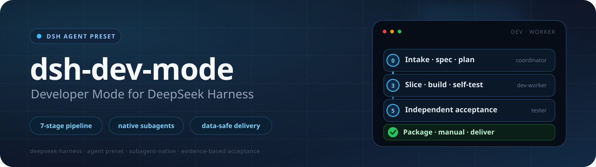
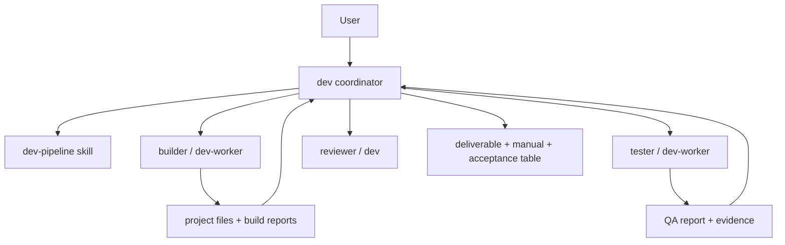

<p align="center">
  
</p>

<p align="center">
  <strong>English</strong> ·
  <a href="README.zh-CN.md">简体中文</a> ·
  <a href="README.zh-TW.md">繁體中文</a>
</p>

<p align="center">
  <a href="https://github.com/lingyingaojue/dsh-dev-mode/releases"></a>
  <a href="https://github.com/lingyingaojue/dsh-dev-mode/actions/workflows/ci.yml"></a>
  <a href="LICENSE"></a>
  
  
  <a href="CONTRIBUTING.md"></a>
</p>

<h1 align="center">Developer Mode for DeepSeek Harness</h1>

<p align="center">
  <strong>Describe the program you want in plain language. Get back something that actually runs, was tested independently, and comes with a manual and an acceptance table.</strong>
</p>

<p align="center">
  <a href="#why-developer-mode">Why</a> ·
  <a href="#how-it-works">How it works</a> ·
  <a href="#quick-start">Quick start</a> ·
  <a href="#what-you-get">What you get</a> ·
  <a href="#documentation">Docs</a> ·
  <a href="#contributing">Contributing</a>
</p>

---

## Why Developer Mode?

Most "make me an app" experiences stop at a plausible-looking code block. Developer Mode is built around a different question: **can the result be installed, run, and trusted by someone who does not write code?**

- **Plain language in, working program out.** The user describes the outcome; the agent chooses the stack, writes the plan, builds, tests, packages, and explains.
- **Native subagents, not fragile background scripts.** Implementation and testing run as DSH-native `subagent` activations with a lean executor preset. No local HTTP, cookies, ports, or side scripts.
- **Evidence over claims.** Every acceptance criterion needs a verification method, a result, and an evidence path. Anything unverified is reported as `BLOCKED`, not silently passed.
- **Built for delivery.** Data lives outside the program directory, writes are backed up, the artifact is launched from its final location, and the manual is tested by following it.

> [!NOTE]
> Developer Mode is a **DSH agent preset**, not a separate app. It requires DeepSeek Harness 0.2.2+ and runs inside a normal DSH session.

## At a glance

| | |
| --- | --- |
| **What it is** | A developer-mode agent preset for [DeepSeek Harness](https://github.com/deepseek-ai/deepseek-harness) |
| **Requires** | DSH 0.2.2+ (tested with `0.2.2-rc.3`) |
| **Tested on** | Windows 10/11 |
| **Modes** | `dev` (coordinator) · `dev-worker` (executor) |
| **Pipeline** | 7 stages · 3 lanes · 7 quality gates (G0–G6) |
| **Install** | `github:lingyingaojue/dsh-dev-mode` |
| **Status** | Active · Windows-tested · no runtime dependencies for the plugin itself |

## How it works



| Role | Preset | Responsibility |
| --- | --- | --- |
| Coordinator | `dev` | Intake, scope, stack choice, delegation, review, packaging, delivery, user communication |
| Executor | `dev-worker` | Implements one task at a time, builds, self-tests, writes a report; never talks to the user |
| Pipeline skill | `dev-pipeline` | Seven-stage SOP, task templates, artifact contracts, quality gates, failure exits |
| Reviewer | `dev` fork | Independent plan review for L2 work |
| Tester | `dev-worker` | Independent acceptance; runs the program, collects evidence, writes QA report |

### Seven stages

| Stage | Outcome | Gate |
| --- | --- | --- |
| 0 · Intake & classify | Restated request, at most one question round, lane chosen | G0 request understood |
| 1 · Recon & stack choice | Workspace/runtime check, existing-project read, backup, stack decision | G1 environment feasible |
| 2 · Spec & plan | MVP, non-goals, acceptance criteria, commands, risks, packaging target | G2 criteria verifiable |
| 3 · Vertical slice | Smallest end-to-end path: launch + one core action + persistence | G3 slice runs |
| 4 · Incremental build | Small batches, self-tests, coordinator verifies builds and diffs | G4 features complete |
| 5 · Independent acceptance | Fresh tester runs the artifact, evidence per criterion, regression | G5 acceptance passes |
| 6 · Package & deliver | Final artifact, clean-state launch, shortcut, manual, acceptance table | G6 deliverable usable |

### Three lanes

| Lane | When | What changes |
| --- | --- | --- |
| **L0 · Quick fix** | One file, no new dependency, no data/packaging change, ≤3 criteria | Coordinator implements directly; smoke check; no full plan or independent QA |
| **L1 · Standard** | New small program or moderate change | Brief plan + executor + independent tester; max 2 fix rounds |
| **L2 · Full** | Multi-file, persistent data, packaging, existing program, external dependency | Full plan + independent review + vertical slice + clean-state install test; max 3 fix rounds |

### Quality bar

A result is deliverable only when:

1. It launches from its final artifact/location, not from a development command.
2. Every acceptance criterion has a method, a result, and an evidence path.
3. If it stores data, "close and reopen, data is still there" was actually tested.
4. L1/L2 work was tested by an independent tester, not inferred from code.
5. A non-technical user can follow the manual; the coordinator walked through it first.
6. Anything untested is reported as `BLOCKED` with a reason.

## Quick start

1. **Install** the plugin (see [Install](#install)), then **start a new session** and choose **Developer Mode**.
2. **Describe the outcome**, not the technology. For example:

   > Build me a small bookkeeping tool in this folder. I need to add an entry, see the list, see the balance, and keep the data after closing and reopening. I don't know programming — choose the approach yourself.

3. Answer **at most one round** of questions (often none). The coordinator chooses the stack, writes the plan, delegates implementation, runs independent acceptance, and packages the result.
4. You receive the artifact, a plain-language manual, an acceptance table, and a short self-check list.

> [!NOTE]
> The mode list also shows **Developer Mode · Executor** (`dev-worker`). It is the internal background role and is selected automatically — you do not need to choose it.

> [!TIP]
> If you already have a program, say "change `<program>` to `<requirement>`". The mode backs up the original first, then runs a regression check.

## Install

**Desktop app (recommended)**

1. Open **Settings → Plugins → Install**.
2. Enter `github:lingyingaojue/dsh-dev-mode`.
3. Install, then **start a new session**.

**CLI (profiles you manage yourself)**

```powershell
dsh plugin --profile <your-profile> add github:lingyingaojue/dsh-dev-mode
```

> [!IMPORTANT]
> A profile managed exclusively by the desktop app (named `desktop`) cannot be installed or removed from the CLI. Use the in-app plugin settings instead.

**Upgrade**

Reinstall the plugin using the same method. For local-directory installs, remove it first and then add it again to avoid `ambiguous-install`. Existing sessions keep their original composition; only **new sessions** use the new version.

**Uninstall**

```powershell
dsh plugin --profile <your-profile> remove dsh-dev-mode
```

## What you get

- A runnable artifact: Windows desktop app, command-line tool, or local web page, chosen from what the machine can actually run.
- A plain-language manual: how to open, how to use, where data lives, how to back up/restore, how to uninstall.
- An acceptance table: every criterion with method, result, and evidence path.
- A self-check list: 3–5 "click here → see this" steps a non-technical user can verify.
- A `.dsh-dev/` process record: plan, status, build reports, QA reports, evidence, delivery notes, backups.

<details>
<summary><strong>Generated project layout</strong></summary>

```text
<workspace>/
├─ 程序/<name>/                # new projects; existing programs are edited in place
│  ├─ source, build script, README.md, AGENTS.md, dist/…
│  └─ (Python desktop) core.py / ui.py / app.py / build.ps1 / 启动.bat
└─ .dsh-dev/                   # process record; safe to delete after delivery
   ├─ plan.md
   ├─ status.md
   ├─ review-1.md              # L2 only
   ├─ reports/build-N.md
   ├─ qa/qa-N.md
   ├─ qa/evidence/
   ├─ delivery.md
   └─ backup-<timestamp>/
```

`程序` is the default project folder created by the mode ("programs"); existing projects are edited in place.

</details>

## Requirements & compatibility

| Requirement | Notes |
| --- | --- |
| DeepSeek Harness | **0.2.2+**; tested with `0.2.2-rc.3` |
| Operating system | **Windows 10/11 tested**; other platforms are untested |
| Plugin runtime | None beyond DSH itself — no Node, Python, or .NET required by the plugin |
| Generated program | Chosen from what the machine has: Python 3.10+, Node 18+, or a local web page |
| Permissions | The deployment decides; the mode never silently escalates privileges |

See [docs/COMPATIBILITY.md](docs/COMPATIBILITY.md) for the full matrix, preset-id conflicts, and the DSH `standard` preset sync procedure.

### Upgrading from v1

v2 removes the local HTTP background-session driver and its `coder.mjs`/`lib.mjs` commands. The `dev` preset id and the "Developer Mode" name are unchanged. Old sessions keep their composition; start a new session. Existing `.dsh-dev/plan.md` and QA records remain readable. See [CHANGELOG.md](CHANGELOG.md).

## Documentation

| Document | What it covers |
| --- | --- |
| [docs/README.md](docs/README.md) | Documentation index and audience/language notes |
| [docs/ARCHITECTURE.md](docs/ARCHITECTURE.md) | Presets, native-subagent data flow, stages, gates, artifacts, failure recovery |
| [docs/COMPATIBILITY.md](docs/COMPATIBILITY.md) | DSH versions, platforms, preset ids, runtime selection, v1 migration |
| [docs/FAQ.md](docs/FAQ.md) | Install, permissions, data, SmartScreen, uninstall, missing mode, costs |
| [docs/MAINTAINING.md](docs/MAINTAINING.md) | Local install, activation checks, smoke tests, releases, CI, rollback |
| [docs/TRANSLATIONS.md](docs/TRANSLATIONS.md) | Language policy, status, and how to add a translation |
| [docs/DETAIL.en.md](docs/DETAIL.en.md) | Plugin-manager detail page (English) |
| [skills/dev-pipeline/SKILL.md](skills/dev-pipeline/SKILL.md) | The seven-stage SOP used by the agent (Chinese) |

## Status & roadmap

**Status:** active · `v2.0.1` · Windows-tested · DSH 0.2.2+.

- Validate the flow on macOS/Linux and document remaining platform gaps.
- Add more project archetypes (beyond Python desktop, local web, and CLI).
- Improve GUI acceptance evidence without fragile screen automation.
- Grow community translations; the agent currently replies in Chinese or English.

## Contributing

Bug reports, docs fixes, translations, templates, and preset improvements are welcome.

- Read [CONTRIBUTING.md](CONTRIBUTING.md) before opening a PR.
- For security issues, follow [SECURITY.md](SECURITY.md) — do not open a public issue.
- Be kind: [CODE_OF_CONDUCT.md](CODE_OF_CONDUCT.md).
- Questions and setup help: [SUPPORT.md](SUPPORT.md).

### Translations

| Language | File | Status |
| --- | --- | --- |
| English | [README.md](README.md) | Canonical |
| 简体中文 | [README.zh-CN.md](README.zh-CN.md) | Up to date |
| 繁體中文 | [README.zh-TW.md](README.zh-TW.md) | Up to date |
| Other languages | — | Contributions welcome — see [docs/TRANSLATIONS.md](docs/TRANSLATIONS.md) |

> The plugin's display metadata and the agent's replies are primarily Chinese/English today. Other-language READMEs are introductions; the translation policy in [docs/TRANSLATIONS.md](docs/TRANSLATIONS.md) explains the limits.

## License

MIT © 2026 LingYingAoJue. See [LICENSE](LICENSE).

---

<p align="center">
  <strong>English</strong> ·
  <a href="README.zh-CN.md">简体中文</a> ·
  <a href="README.zh-TW.md">繁體中文</a>
</p>

<p align="center">
  <sub>Built for <a href="https://github.com/deepseek-ai/deepseek-harness">DeepSeek Harness</a> · MIT</sub>
</p>
