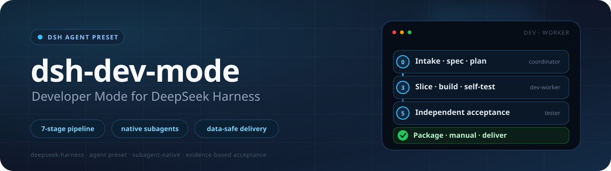
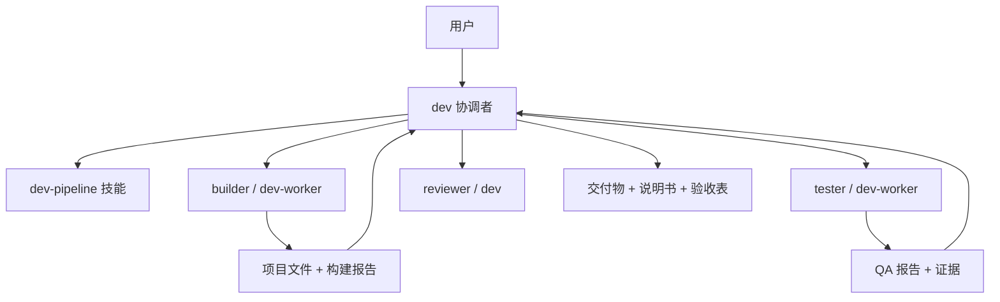

<p align="center">
  
</p>

<p align="center">
  <a href="README.md">English</a> ·
  <strong>简体中文</strong> ·
  <a href="README.zh-TW.md">繁體中文</a>
</p>

<p align="center">
  <a href="https://github.com/lingyingaojue/dsh-dev-mode/releases"></a>
  <a href="https://github.com/lingyingaojue/dsh-dev-mode/actions/workflows/ci.yml"></a>
  <a href="LICENSE"></a>
  
  
  <a href="CONTRIBUTING.md"></a>
</p>

<h1 align="center">DeepSeek Harness 开发者模式</h1>

<p align="center">
  <strong>用大白话描述你想要的程序，拿回来的东西真的能跑、经过独立测试，还附带一份说明书和一张验收表。</strong>
</p>

<p align="center">
  <a href="#why-developer-mode">为什么</a> ·
  <a href="#how-it-works">工作原理</a> ·
  <a href="#quick-start">快速开始</a> ·
  <a href="#what-you-get">你会得到什么</a> ·
  <a href="#documentation">文档</a> ·
  <a href="#contributing">参与贡献</a>
</p>

---

<a id="why-developer-mode" name="why-developer-mode"></a>

## 为什么要开发者模式？

大多数「帮我做个程序」的体验，到给出一个看起来像那么回事的代码块就结束了。开发者模式换了个问题来衡量成败：**一个不写代码的人，能不能把这个结果装上、跑起来，并且放心使用？**

- **大白话提需求，拿到能跑的程序。** 用户只描述想要的结果；选技术栈、写方案、实现、测试、打包和讲解，全由智能体完成。
- **原生子代理，不用脆弱的后台脚本。** 实现和测试都由 DSH 原生的 `subagent` 承担，配一套精简的执行器预设。不需要本地 HTTP、cookie、端口，也不用旁路脚本。
- **看证据，不看口头承诺。** 每条验收标准都必须有验证方法、结果和证据路径。没验证过的内容一律标成 `BLOCKED`，不会悄悄算通过。
- **从一开始就冲着交付去。** 数据放在程序目录之外，写入前先备份，成品从最终位置启动，说明书要照着走一遍才算数。

> [!NOTE]
> 开发者模式是一个 **DSH 智能体预设**，不是独立软件。它需要 DeepSeek Harness 0.2.2+，在普通的 DSH 会话里运行。

## 一眼看懂

| | |
| --- | --- |
| **它是什么** | 面向 [DeepSeek Harness](https://github.com/deepseek-ai/deepseek-harness) 的开发者模式智能体预设 |
| **需要什么** | DSH 0.2.2+（实测 `0.2.2-rc.3`） |
| **实测平台** | Windows 10/11 |
| **运行模式** | `dev`（协调者）· `dev-worker`（执行器） |
| **流程** | 7 个阶段 · 3 种档位 · 7 道质量门（G0–G6） |
| **安装参数** | `github:lingyingaojue/dsh-dev-mode` |
| **当前状态** | 活跃维护 · Windows 已实测 · 插件本身没有运行时依赖 |

<a id="how-it-works" name="how-it-works"></a>

## 工作原理



| 角色 | 预设 | 职责 |
| --- | --- | --- |
| 协调者 | `dev` | 接单、划范围、定技术栈、派活、评审、打包、交付、和用户沟通 |
| 执行器 | `dev-worker` | 一次只做一个任务，构建、自测、写报告；从不直接和用户对话 |
| 流程技能 | `dev-pipeline` | 七阶段标准流程、任务模板、工件契约、质量门、失败出口 |
| 评审员 | `dev` 派生（fork） | 为 L2 工作做独立的方案评审 |
| 测试员 | `dev-worker` | 独立验收；运行程序、收集证据、写 QA 报告 |

### 七个阶段

| 阶段 | 产出 | 质量门 |
| --- | --- | --- |
| 0 · 接单与分级 | 复述需求，最多一轮提问，选定档位 | G0 需求已理解 |
| 1 · 勘察与技术选型 | 检查工作目录和运行时、通读现有工程、先做备份、确定技术栈 | G1 环境可行 |
| 2 · 规格与方案 | MVP、不做什么、验收标准、命令、风险、打包目标 | G2 标准可验证 |
| 3 · 垂直切片 | 最短的端到端路径：能启动 + 一个核心动作 + 数据能存住 | G3 切片可运行 |
| 4 · 分批实现 | 小批量推进、逐批自测；协调者核对构建结果和代码改动 | G4 功能齐全 |
| 5 · 独立验收 | 换一个全新的测试员运行成品，逐条给出证据，并回归检查上一轮的功能 | G5 验收通过 |
| 6 · 打包与交付 | 最终成品、干净状态启动、快捷方式、说明书、验收表 | G6 交付可用 |

### 三种档位

| 档位 | 什么时候用 | 有什么不同 |
| --- | --- | --- |
| **L0 · 快修** | 只动一个文件、不新增依赖、不改数据和打包、验收标准不超过 3 条 | 协调者直接动手；做冒烟检查；不写完整方案，也不做独立 QA |
| **L1 · 标准** | 新的小型程序或中等改动 | 简要方案 + 执行器 + 独立测试员；最多 2 轮修复 |
| **L2 · 完整** | 涉及多个文件、要长期保存数据、需要打包、修改现有程序、依赖外部组件 | 完整方案 + 独立评审 + 垂直切片 + 干净环境安装测试；最多 3 轮修复 |

### 交付标准

只有同时满足下面几条，结果才算可交付：

1. 从最终的成品和最终位置启动，而不是从某条开发命令启动。
2. 每条验收标准都有验证方法、结果和证据路径。
3. 只要程序会存数据，「关掉再打开，数据还在」就是真的测过的。
4. L1/L2 的工作由独立测试员测过，不是从代码里推出来的。
5. 不懂技术的用户能照着说明书操作；而且协调者已经先照着走过一遍。
6. 任何没测过的内容，都以 `BLOCKED` 加原因上报。

<a id="quick-start" name="quick-start"></a>

## 快速开始

1. **安装**插件（见[安装](#install)），然后**新建一个会话**，选择 **开发者模式**。
2. **描述你要的结果**，而不是技术方案。比如：

   > 帮我在这个文件夹里做一个小记账工具。我要能记一笔、看列表、看余额，关掉再打开数据还在。我不懂编程，用什么方式你定。

3. **最多回答一轮**问题（常常一个问题都没有）。协调者会选技术栈、写方案、安排实现、做独立验收，然后打包交付。
4. 你最后拿到的是：一份成品、一份说人话的说明书、一张验收表，还有一份简短的自检清单。

> [!NOTE]
> 模式列表里还会出现 **开发者模式 · 执行器**（`dev-worker`）。它是内部的后台角色，会自动选用，你不用手动挑它。

> [!TIP]
> 如果你已经有现成的程序，直接说「把 `<程序>` 改成 `<要求>`」。模式会先备份原程序，再做回归检查。

<a id="install" name="install"></a>

## 安装

**桌面版（推荐）**

1. 打开 **设置 → 插件 → 安装**。
2. 填入 `github:lingyingaojue/dsh-dev-mode`。
3. 安装完成后**新建一个会话**。

**命令行（自己管理 profile 的场景）**

```powershell
dsh plugin --profile <your-profile> add github:lingyingaojue/dsh-dev-mode
```

> [!IMPORTANT]
> 如果你用的 profile 完全由桌面版管理（名为 `desktop`），就不能用命令行安装或卸载，请改用应用内的插件设置。

**升级**

用同样的方式重新安装即可。如果是从本地目录安装的，先卸载再重新添加，避免出现 `ambiguous-install`。已有会话保持原来的组成不变，只有**新建的会话**才会用上新版本。

**卸载**

```powershell
dsh plugin --profile <your-profile> remove dsh-dev-mode
```

<a id="what-you-get" name="what-you-get"></a>

## 你会得到什么

- 一个能直接运行的成品：Windows 桌面程序、命令行工具或本地网页，按这台机器实际能跑什么来定。
- 一份说人话的说明书：怎么打开、怎么用、数据存在哪、怎么备份和恢复、怎么卸载。
- 一张验收表：每条验收标准都对应方法、结果和证据路径。
- 一份自检清单：3–5 条「点这里 → 看到这个」，不懂技术的用户也能自己核对。
- 一份 `.dsh-dev/` 过程记录：方案、状态、构建报告、QA 报告、证据、交付说明和备份。

<details>
<summary><strong>生成的工程目录结构</strong></summary>

```text
<workspace>/
├─ 程序/<name>/                # new projects; existing programs are edited in place
│  ├─ source, build script, README.md, AGENTS.md, dist/…
│  └─ (Python desktop) core.py / ui.py / app.py / build.ps1 / 启动.bat
└─ .dsh-dev/                   # process record; safe to delete after delivery
   ├─ plan.md
   ├─ status.md
   ├─ review-1.md              # L2 only
   ├─ reports/build-N.md
   ├─ qa/qa-N.md
   ├─ qa/evidence/
   ├─ delivery.md
   └─ backup-<timestamp>/
```

`程序` 是这个模式默认创建的项目文件夹（对应英文 “programs”）；已有项目会在原目录直接修改，不会被搬走。

</details>

## 环境要求与兼容性

| 要求 | 说明 |
| --- | --- |
| DeepSeek Harness | **0.2.2+**；实测 `0.2.2-rc.3` |
| 操作系统 | **Windows 10/11 已实测**；其他平台尚未测试 |
| 插件运行时 | 除 DSH 本身外不需要别的运行时——插件不要求 Node、Python 或 .NET |
| 生成的程序 | 按这台机器已有的环境来选：Python 3.10+、Node 18+，或者本地网页 |
| 权限 | 由部署方的权限策略决定；开发者模式不会悄悄提权 |

完整的兼容矩阵、预设 id 冲突，以及 DSH `standard` 预设的同步步骤，见 [docs/COMPATIBILITY.md](docs/COMPATIBILITY.md)。

### 从 v1 升级

v2 移除了本地 HTTP 后台会话驱动，以及配套的 `coder.mjs`/`lib.mjs` 命令。`dev` 预设 id 和「开发者模式」这个名字都保持不变。旧会话保留原来的组成，请新建一个会话。已有的 `.dsh-dev/plan.md` 和 QA 记录仍然可以打开查看。详见 [CHANGELOG.md](CHANGELOG.md)。

<a id="documentation" name="documentation"></a>

## 文档

| 文档 | 内容 |
| --- | --- |
| [docs/README.md](docs/README.md) | 文档索引，以及读者对象和语言说明 |
| [docs/ARCHITECTURE.md](docs/ARCHITECTURE.md) | 预设、原生子代理的数据流、阶段、质量门、工件、失败恢复 |
| [docs/COMPATIBILITY.md](docs/COMPATIBILITY.md) | DSH 版本、平台、预设 id、运行时选择、v1 迁移 |
| [docs/FAQ.md](docs/FAQ.md) | 安装、权限、数据、SmartScreen、卸载、模式不显示、费用 |
| [docs/MAINTAINING.md](docs/MAINTAINING.md) | 本地安装、激活检查、冒烟测试、发布、CI、回滚 |
| [docs/TRANSLATIONS.md](docs/TRANSLATIONS.md) | 语言政策、当前状态、如何新增一种翻译 |
| [docs/DETAIL.en.md](docs/DETAIL.en.md) | 插件管理器详情页（英文） |
| [skills/dev-pipeline/SKILL.md](skills/dev-pipeline/SKILL.md) | 智能体使用的七阶段 SOP（中文） |

## 状态与路线图

**当前状态：** 活跃维护 · `v2.0.1` · Windows 已实测 · DSH 0.2.2+。

- 在 macOS/Linux 上验证流程，并记录各平台尚存的差距。
- 增加更多项目类型（目前有 Python 桌面、本地网页和命令行）。
- 改进图形界面的验收证据，同时不依赖容易失效的屏幕自动化。
- 丰富社区翻译；目前智能体只用中文或英文回复。

<a id="contributing" name="contributing"></a>

## 参与贡献

欢迎提交 bug 报告、文档修正、翻译、模板和预设改进。

- 提 PR 之前请先读 [CONTRIBUTING.md](CONTRIBUTING.md)。
- 安全问题请按 [SECURITY.md](SECURITY.md) 处理——不要开公开 issue。
- 保持友善：[CODE_OF_CONDUCT.md](CODE_OF_CONDUCT.md)。
- 提问和安装求助：[SUPPORT.md](SUPPORT.md)。

### 翻译

| 语言 | 文件 | 状态 |
| --- | --- | --- |
| 英文 | [README.md](README.md) | 基准版本（canonical） |
| 简体中文 | [README.zh-CN.md](README.zh-CN.md) | 已同步最新 |
| 繁體中文 | [README.zh-TW.md](README.zh-TW.md) | 已同步最新 |
| 其他语言 | — | 欢迎贡献——见 [docs/TRANSLATIONS.md](docs/TRANSLATIONS.md) |

> 目前插件在界面上展示的信息和智能体的回复，都以中文/英文为主。其他语言的 README 只是介绍性质；[docs/TRANSLATIONS.md](docs/TRANSLATIONS.md) 里的翻译政策说明了这样做的边界。

## 许可证

MIT © 2026 LingYingAoJue。详见 [LICENSE](LICENSE)。

---

<p align="center">
  <a href="README.md">English</a> ·
  <strong>简体中文</strong> ·
  <a href="README.zh-TW.md">繁體中文</a>
</p>

<p align="center">
  <sub>为 <a href="https://github.com/deepseek-ai/deepseek-harness">DeepSeek Harness</a> 打造 · MIT</sub>
</p>
