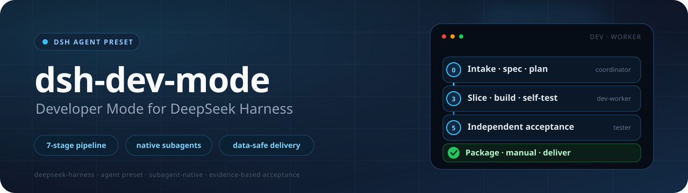
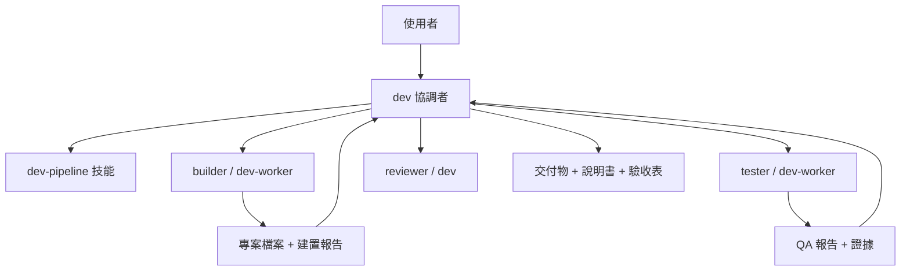

<p align="center">
  
</p>

<p align="center">
  <a href="README.md">English</a> ·
  <a href="README.zh-CN.md">简体中文</a> ·
  <strong>繁體中文</strong>
</p>

<p align="center">
  本文件為繁體中文介紹；外掛介面與代理回覆以簡體中文/英文為主。
</p>

<p align="center">
  <a href="https://github.com/lingyingaojue/dsh-dev-mode/releases"></a>
  <a href="https://github.com/lingyingaojue/dsh-dev-mode/actions/workflows/ci.yml"></a>
  <a href="LICENSE"></a>
  
  
  <a href="CONTRIBUTING.md"></a>
</p>

<h1 align="center">DeepSeek Harness 開發者模式</h1>

<p align="center">
  <strong>用日常語言描述你想要的程式，拿回來的成品真的跑得起來、經過獨立測試，而且附有使用說明與驗收表。</strong>
</p>

<p align="center">
  <a href="#why-developer-mode">為什麼</a> ·
  <a href="#how-it-works">運作方式</a> ·
  <a href="#quick-start">快速開始</a> ·
  <a href="#what-you-get">你會拿到什麼</a> ·
  <a href="#documentation">文件</a> ·
  <a href="#contributing">參與貢獻</a>
</p>

---

<a id="why-developer-mode"></a>

## 為什麼要有開發者模式？

多數「幫我做一個應用程式」的體驗，最後都停在一個看起來很合理的程式碼區塊。開發者模式從另一個問題出發：**成品能不能讓一個不寫程式的人安裝、執行，並且放心信任？**

- **用白話說需求，換來能跑的程式。** 使用者描述想要的結果；代理負責選技術棧、寫計畫、建置、測試、打包，並把做法說清楚。
- **原生子代理，而不是脆弱的背景腳本。** 實作與測試都以 DSH 原生的 `subagent` 啟動，搭配精簡的執行器預設；不需要本機 HTTP、Cookie、連接埠或輔助腳本。
- **證據重於宣稱。** 每條驗收標準都需要驗證方法、結果與證據路徑；沒驗證到的一律標記為 `BLOCKED`，不會默默當作通過。
- **為交付而打造。** 資料放在程式目錄之外、寫入前有備份、成品從最終位置啟動，說明書也會實際照著操作一遍來驗證。

> [!NOTE]
> 開發者模式是**一個 DSH 代理預設**，不是獨立的應用程式。它需要 DeepSeek Harness 0.2.2+，並在一般的 DSH 工作階段中執行。

## 概覽

| | |
| --- | --- |
| **這是什麼** | [DeepSeek Harness](https://github.com/deepseek-ai/deepseek-harness) 的開發者模式代理預設 |
| **需求** | DSH 0.2.2+（以 `0.2.2-rc.3` 實測） |
| **實測平台** | Windows 10/11 |
| **模式** | `dev`（協調者）· `dev-worker`（執行器） |
| **流程** | 7 個階段 · 3 種檔次 · 7 道品質關卡（G0–G6） |
| **安裝** | `github:lingyingaojue/dsh-dev-mode` |
| **狀態** | 活躍維護 · 已於 Windows 實測 · 外掛本身沒有額外的執行期相依 |

<a id="how-it-works"></a>

## 運作方式



| 角色 | 預設 | 職責 |
| --- | --- | --- |
| 協調者 | `dev` | 接單、界定範圍、技術選型、分派、審查、打包、交付，以及與使用者溝通 |
| 執行器 | `dev-worker` | 一次實作一項任務，負責建置、自測、撰寫報告；不與使用者對話 |
| 流程技能 | `dev-pipeline` | 七階段 SOP、任務範本、產出物契約、品質關卡、失敗出口 |
| 審查者 | 由 `dev` 派生（fork） | 為 L2 工作做獨立的計畫審查 |
| 測試者 | `dev-worker` | 獨立驗收；實際執行成品、蒐集證據、撰寫 QA 報告 |

### 七個階段

| 階段 | 結果 | 關卡 |
| --- | --- | --- |
| 0 · 接單與分級 | 重述需求、最多一輪提問、選定檔次 | G0 需求已理解 |
| 1 · 環境盤點與技術選型 | 工作區／執行環境檢查、研讀既有專案、備份、技術決策 | G1 環境可行 |
| 2 · 規格與計畫 | MVP、非目標、驗收標準、指令、風險、打包目標 | G2 標準可驗證 |
| 3 · 垂直切片 | 最小的端到端路徑：啟動 + 一個核心操作 + 資料持久化 | G3 切片可執行 |
| 4 · 分批建置 | 小批次推進、自測，協調者核對建置與差異 | G4 功能完整 |
| 5 · 獨立驗收 | 全新的測試者執行成品、逐條蒐集證據、回歸檢查 | G5 驗收通過 |
| 6 · 打包與交付 | 最終成品、乾淨環境啟動、捷徑、說明書、驗收表 | G6 交付物可用 |

### 三種檔次

| 檔次 | 適用時機 | 做法差異 |
| --- | --- | --- |
| **L0 · 快修** | 單一檔案、沒有新增相依套件、不涉及資料或打包變更、驗收標準不超過 3 條 | 協調者直接實作；做基本啟動檢查；不需要完整計畫或獨立 QA |
| **L1 · 標準** | 新的小型程式或中等幅度變更 | 簡要計畫 + 執行器 + 獨立測試者；最多 2 輪修正 |
| **L2 · 完整** | 多檔案、需持久化資料、需打包、既有程式、外部相依 | 完整計畫 + 獨立審查 + 垂直切片 + 乾淨環境安裝測試；最多 3 輪修正 |

### 品質門檻

只有滿足以下條件，成果才算可交付：

1. 成品從最終的位置啟動，而不是靠開發指令啟動。
2. 每條驗收標準都有驗證方法、結果與證據路徑。
3. 若有儲存資料，必須實際測試過「關掉再打開，資料還在」。
4. L1／L2 的工作由獨立測試者實測，不能只憑讀程式碼推論。
5. 不懂程式的人能照著說明書操作；協調者已先照著走過一遍。
6. 任何未經測試的項目，都要標記為 `BLOCKED` 並註明原因。

<a id="quick-start"></a>

## 快速開始

1. **安裝**外掛（見[安裝](#install)），接著**開一個新的工作階段**，並選擇**開發者模式**。
2. **描述你想要的結果**，而不是技術。例如：

   > 幫我在這個資料夾做一個小型的記帳工具。我要能新增一筆、看清單、看餘額，關掉再打開資料還在。我不懂程式，方法由你決定。

3. 最多回答**一輪**問題（通常一個問題都沒有）。協調者會選技術棧、寫計畫、分派實作、執行獨立驗收，最後把成品打包交付。
4. 你會拿到成品、白話說明書、驗收表，以及一份簡短的自檢清單。

> [!NOTE]
> 模式清單中還會看到**開發者模式 · 執行器**（`dev-worker`）。那是內部的背景角色，會自動被選用——你不需要手動選擇。

> [!TIP]
> 如果你已經有一個程式，只要說「把 `<program>` 改成 `<requirement>`」。模式會先備份原始版本，再執行回歸檢查。

<a id="install"></a>

## 安裝

**桌面應用程式（建議）**

1. 開啟**設定 → 外掛 → 安裝**。
2. 輸入 `github:lingyingaojue/dsh-dev-mode`。
3. 安裝完成後，**開一個新的工作階段**。

**命令列（自行管理的 profile）**

```powershell
dsh plugin --profile <your-profile> add github:lingyingaojue/dsh-dev-mode
```

> [!IMPORTANT]
> 由桌面應用程式專屬管理的 profile（名稱為 `desktop`）無法從命令列安裝或移除。請改用應用程式內的外掛設定。

**升級**

用相同的方式重新安裝外掛。若是從本機目錄安裝，請先移除再加入，以免出現 `ambiguous-install`。既有工作階段會保留原本的組成；只有**新的工作階段**會使用新版本。

**解除安裝**

```powershell
dsh plugin --profile <your-profile> remove dsh-dev-mode
```

<a id="what-you-get"></a>

## 你會拿到什麼

- 可實際執行的成品：Windows 桌面應用程式、命令列工具或本機網頁，依這台機器實際能執行的環境來選擇。
- 白話說明書：怎麼開啟、怎麼使用、資料放在哪裡、如何備份與還原、如何解除安裝。
- 驗收表：每條標準都附上驗證方法、結果與證據路徑。
- 自檢清單：3–5 個「點這裡 → 看到這個」的步驟，讓不懂程式的人也能自行確認。
- 一份 `.dsh-dev/` 過程記錄：計畫、狀態、建置報告、QA 報告、證據、交付說明與備份。

<details>
<summary><strong>產生的專案結構</strong></summary>

```text
<workspace>/
├─ 程序/<name>/                # new projects; existing programs are edited in place
│  ├─ source, build script, README.md, AGENTS.md, dist/…
│  └─ (Python desktop) core.py / ui.py / app.py / build.ps1 / 启动.bat
└─ .dsh-dev/                   # process record; safe to delete after delivery
   ├─ plan.md
   ├─ status.md
   ├─ review-1.md              # L2 only
   ├─ reports/build-N.md
   ├─ qa/qa-N.md
   ├─ qa/evidence/
   ├─ delivery.md
   └─ backup-<timestamp>/
```

`程序` 是模式預設建立的專案資料夾名稱（即「programs」）；既有專案則直接就地修改。

</details>

## 需求與相容性

| 需求 | 說明 |
| --- | --- |
| DeepSeek Harness | **0.2.2+**；以 `0.2.2-rc.3` 實測 |
| 作業系統 | **已實測 Windows 10/11**；其他平台尚未實測 |
| 外掛執行環境 | 除了 DSH 本身之外都不需要——外掛不需要 Node、Python 或 .NET |
| 產生的程式 | 依機器實際具備的環境選擇：Python 3.10+、Node 18+ 或本機網頁 |
| 權限 | 由部署方決定；模式不會擅自提高權限 |

完整對照表、預設 ID 衝突，以及 DSH `standard` 預設的同步流程，請見 [docs/COMPATIBILITY.md](docs/COMPATIBILITY.md)。

### 從 v1 升級

v2 移除了本機 HTTP 背景工作階段驅動程式，以及它附帶的 `coder.mjs`／`lib.mjs` 指令。`dev` 預設 ID 與「開發者模式」名稱都沒有改變。舊工作階段會保留原本的組成；請開一個新的工作階段。既有的 `.dsh-dev/plan.md` 與 QA 記錄仍可讀取。詳見 [CHANGELOG.md](CHANGELOG.md)。

<a id="documentation"></a>

## 文件

| 文件 | 內容 |
| --- | --- |
| [docs/README.md](docs/README.md) | 文件索引與讀者／語言說明 |
| [docs/ARCHITECTURE.md](docs/ARCHITECTURE.md) | 預設、原生子代理的資料流、階段、品質關卡、產出物、失敗復原 |
| [docs/COMPATIBILITY.md](docs/COMPATIBILITY.md) | DSH 版本、平台、預設 ID、執行環境選擇、v1 移轉 |
| [docs/FAQ.md](docs/FAQ.md) | 安裝、權限、資料、SmartScreen、解除安裝、找不到模式、費用 |
| [docs/MAINTAINING.md](docs/MAINTAINING.md) | 本機安裝、啟用檢查、冒煙測試、發行、CI、回復 |
| [docs/TRANSLATIONS.md](docs/TRANSLATIONS.md) | 語言政策、目前狀態，以及如何新增翻譯 |
| [docs/DETAIL.en.md](docs/DETAIL.en.md) | 外掛管理器詳情頁（英文） |
| [skills/dev-pipeline/SKILL.md](skills/dev-pipeline/SKILL.md) | 代理使用的七階段 SOP（中文） |

## 狀態與路線圖

**狀態：** 活躍維護 · `v2.0.1` · 已於 Windows 實測 · DSH 0.2.2+。

- 在 macOS／Linux 上驗證流程，並記錄仍待補齊的平台差異。
- 新增更多專案類型（不只 Python 桌面程式、本機網頁與 CLI）。
- 在不依賴脆弱螢幕自動化的前提下，改善 GUI 驗收的證據品質。
- 擴大社群翻譯；代理目前以中文或英文回覆。

<a id="contributing"></a>

## 參與貢獻

歡迎回報錯誤、修正文件、貢獻翻譯與範本，或改進預設。

- 送出 PR 前請先閱讀 [CONTRIBUTING.md](CONTRIBUTING.md)。
- 資安問題請依 [SECURITY.md](SECURITY.md) 處理——不要開公開 issue。
- 請保持友善：[CODE_OF_CONDUCT.md](CODE_OF_CONDUCT.md)。
- 問題與安裝協助：[SUPPORT.md](SUPPORT.md)。

### 翻譯

| 語言 | 檔案 | 狀態 |
| --- | --- | --- |
| English | [README.md](README.md) | 基準版本（canonical） |
| 简体中文 | [README.zh-CN.md](README.zh-CN.md) | 已同步 |
| 繁體中文 | [README.zh-TW.md](README.zh-TW.md) | 已同步 |
| 其他語言 | — | 歡迎貢獻——見 [docs/TRANSLATIONS.md](docs/TRANSLATIONS.md) |

> 目前外掛的顯示資訊與代理回覆以中文／英文為主。其他語言的 README 屬於介紹性質；[docs/TRANSLATIONS.md](docs/TRANSLATIONS.md) 中的翻譯政策說明了相關限制。

## 授權條款

MIT © 2026 LingYingAoJue。詳見 [LICENSE](LICENSE)。

---

<p align="center">
  <a href="README.md">English</a> ·
  <a href="README.zh-CN.md">简体中文</a> ·
  <strong>繁體中文</strong>
</p>

<p align="center">
  <sub>為 <a href="https://github.com/deepseek-ai/deepseek-harness">DeepSeek Harness</a> 打造 · MIT</sub>
</p>
