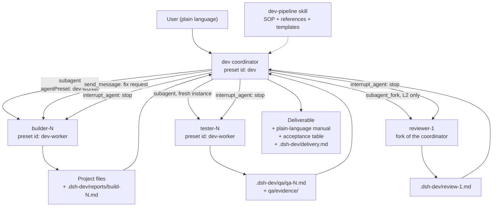
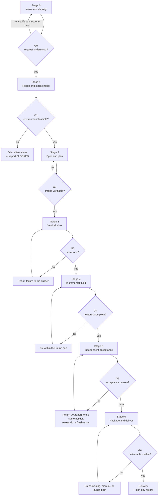

# Architecture

This page explains how dsh-dev-mode is built: the two agent presets it installs, how the coordinator delegates work to DSH-native subagents, how the seven stages and seven quality gates are enforced, which artifacts are produced, and how the flow recovers when something fails. It describes plugin version **2.0.1**; internals may change in later releases. See [COMPATIBILITY.md](COMPATIBILITY.md) for the version policy and [CHANGELOG.md](../CHANGELOG.md) for the v2 redesign.

## 1. What the plugin installs

The plugin is a DSH bundle, not a standalone application. [`cordis.patch.yml`](../cordis.patch.yml) inserts two `@deepseek-ai/dsh-agent-preset` entries into the profile that installs the bundle:

| Component | Bundle id | Preset id | Display name | Order | Role |
| --- | --- | --- | --- | --- | --- |
| Coordinator | `preset-dev` | `dev` | Developer Mode | 1 | Talks to the user, plans, delegates, reviews, packages, delivers |
| Executor | `preset-dev-worker` | `dev-worker` | Developer Mode · Executor | 90 | Implements one task at a time, builds, self-tests, reports; never talks to the user |

A third component is not a preset: the **`dev-pipeline` skill** ([`skills/dev-pipeline/SKILL.md`](../skills/dev-pipeline/SKILL.md)) is loaded by the coordinator at the start of a task. It carries the detailed seven-stage SOP, task-brief templates, artifact contracts, quality gates, and failure exits. Splitting the procedure into a skill keeps the persona short, which saves tokens on every turn; the skill is loaded only when the mode actually works.

The coordinator's plugin list is a copy of the DSH `standard` preset (see [COMPATIBILITY.md](COMPATIBILITY.md#the-standard-preset-baseline)) with four deliberate differences: the persona, the custom skill directory for `dev-pipeline`, `interrupt: true` on the subagent-control tool, and `agentPreset: dev-worker` on the `subagent` tool. The executor preset is deliberately much smaller.

| Capability | Coordinator (`dev`) | Executor (`dev-worker`) |
| --- | --- | --- |
| User interaction (`ask_user_question`, `present`) | Yes | No |
| Planning (`todo_write`, plan mode, goals) | Yes | No |
| Delegation (`subagent`, `subagent_fork`, `interrupt_agent`) | Yes | No |
| Files, search, shell, background jobs | Yes | Yes |
| Web, schedule, Office, plugin manager | Yes | No |
| Compaction and tool-result pruning | Yes | Yes |

## 2. Why two presets

- **Context discipline.** The coordinator's prompt and tool catalog are large because it must talk to the user and orchestrate. Builders and testers do not need user-facing tools, planning, or other subagents; a lean preset keeps their context focused on the current task and reduces per-turn token cost.
- **Independent verification.** A separate tester instance is spawned for acceptance. It starts from a fresh context, runs the artifact, and writes its own report, so a "PASS" is not the implementer grading its own work.
- **Scope control.** The executor persona only modifies paths named in the task brief inside the project directory. This is a behavioral contract, not a sandbox; the actual sandbox and permission mode come from the DSH deployment.
- **Automatic selection.** The executor is selected automatically through the `subagent` tool's `agentPreset: dev-worker` setting. Users never need to pick "Developer Mode · Executor"; the mode list shows it so that the composition is inspectable.

## 3. Top-level data flow



## 4. How delegation works

### 4.1 Spawning an executor

The coordinator calls `subagent` with a self-contained task brief. The subagent has its own context and cannot see the user conversation, so the brief must carry everything it needs: the absolute project directory, the absolute path to `plan.md`, the one goal for this round, the paths it may modify, the baseline command, the completion criteria, the report path, and the required machine markers. The `subagent` tool is configured in the coordinator preset with `agentPreset: dev-worker`, so no model or preset override is needed.

Rules that the coordinator and skill enforce:

- One small, verifiable goal per round; no scope expansion without a new round.
- All commands must be non-interactive (`--yes` and similar); a command that waits for keyboard input is the most common way an executor stalls.
- Only one executor writes code in a project at a time.
- Fix rounds return to the **same** builder via `send_message`, not to a new one, so it keeps its working context.

### 4.2 Waiting without polling

Starting a subagent effectively ends the coordinator's turn: there is nothing useful to do until the child reports back. DSH delivers a completion notice when the child finishes, and the coordinator resumes then. This replaces the v1 design, where a spawn script had to poll a local HTTP endpoint for up to 540 seconds.

The coordinator must not busy-poll. It may call `list_agents` when the user asks for status, but it does not sleep or spin while waiting.

### 4.3 Reports and machine markers

Every executor round ends by writing `.dsh-dev/reports/build-N.md` and a trailer that the coordinator parses without showing it to the user:

```text
BUILD=OK|FAIL|BLOCKED
CHANGED=<relative paths, comma-separated>
RUN=<launch command>
SELFTEST=<self-test command and result summary>
EVIDENCE=<evidence path>
BLOCKERS=<none or concrete reason>
REPORT=<absolute report path>
```

Testers write `.dsh-dev/qa/qa-N.md` and end with `QARESULT=PASS|FAIL|BLOCKED` and `QA_REPORT=<absolute path>`. The coordinator treats these markers as its own decision input; the user sees a plain-language summary instead.

### 4.4 Independent review forks (L2)

For L2 work, the coordinator uses `subagent_fork` to create `reviewer-1`. Because a fork inherits the coordinator's conversation, the reviewer can compare the plan against the user's exact words without a long reconstruction brief. It reads `plan.md`, writes `.dsh-dev/review-1.md` with `[必须改]` (must fix), `[建议改]` (suggest), and `[通过]` (pass) items, and does not modify the plan itself. The coordinator fixes the plan first if anything is marked must-fix, and only asks the user again if the correction changes visible scope or timing.

### 4.5 Steering and stopping

| Situation | Mechanism | Effect |
| --- | --- | --- |
| Add a requirement while a round is running | `send_message` or record it in `status.md` for the next round | Does not interrupt files being written |
| Nudge a stalled executor | `send_message` with a concrete correction | Reaches the child at its next step |
| Stop a stuck round | `interrupt_agent` | Cancels the child; the coordinator splits the task or takes over |
| User cancels the task | `interrupt_agent` for every child, then update `status.md` | Progress is preserved on disk; the session is not archived or deleted |

The coordinator may take over implementation itself if the executor preset cannot start. It must not retry the same failing activation repeatedly.

## 5. The seven stages



| Stage | What happens | Primary output | Gate | Lane notes |
| --- | --- | --- | --- | --- |
| 0 · Intake and classify | Restate the request, ask at most one round of user-only questions, choose L0/L1/L2, open a stage-level todo list | `status.md` | G0 | Same for all lanes |
| 1 · Recon and stack choice | Check write access, OS, Python/Node/.NET, packaging tools, git; read an existing project; back up before changes; choose the stack | Plan environment and stack sections | G1 | Same for all lanes |
| 2 · Spec and plan | MVP, non-goals, acceptance criteria with verification methods, technical approach, file list, run/build commands, risks and rollback; L2 gets an independent review | `plan.md`, `review-1.md` (L2) | G2 | L0 may record only a line in `status.md` |
| 3 · Vertical slice | Smallest end-to-end path: launch + one core action + data written and read back | `reports/build-1.md` | G3 | Coordinator builds directly at L0; builder for L1/L2 |
| 4 · Incremental build | Small batches, each self-tested; the coordinator independently reruns builds/self-tests and checks the diff is in scope | `reports/build-N.md`, `status.md` | G4 | L1/L2 use a builder |
| 5 · Independent acceptance | A fresh tester runs the artifact, checks every criterion with method/result/evidence, regresses the previous round | `qa/qa-N.md`, `qa/evidence/` | G5 | L1/L2; L0 uses a smoke check |
| 6 · Package and deliver | Final artifact installed at its final location, clean-state launch, shortcut, plain-language manual, acceptance table, self-check list | `delivery.md`, artifact | G6 | L0 delivers directly; packaging applies when the task produces an artifact |

### Lanes

| Lane | Criteria | What changes |
| --- | --- | --- |
| **L0 · Quick fix** | One file, no new dependency, no data-structure or packaging change, at most 3 acceptance criteria | Coordinator implements directly and runs a smoke check; no full plan and no independent QA |
| **L1 · Standard** | Default for a new small program or a moderate change | Brief plan, builder, independent tester; fix rounds capped at 2 |
| **L2 · Full** | Multiple files, persistent data, packaging, an existing program, or an external dependency | Full plan, independent review, vertical slice, clean-state install test; fix rounds capped at 3 |

When unsure, the coordinator starts at L1. If the work turns out to be larger than expected, it upgrades the lane and tells the user in one sentence.

## 6. Quality gates

The pipeline records seven quality gates numbered **G0–G6**: G0 is the intake gate, and G1–G6 close the six stages that produce and deliver the artifact.

| Gate | Certified at | Pass criteria |
| --- | --- | --- |
| **G0** | End of stage 0 | Request restated consistently; at most one question round; lane choice justified |
| **G1** | End of stage 1 | Workspace writable; chosen stack can run and be packaged on this machine; data path explicit; existing program backed up |
| **G2** | End of stage 2 | Every acceptance criterion has a verification method; non-goals and packaging target named; risks and rollback recorded |
| **G3** | End of stage 3 | Artifact launches; one core action works; data is stored and read back; evidence on disk |
| **G4** | End of stage 4 | MVP implemented; builds and self-tests pass; diff within scope; no critical TODO left |
| **G5** | End of stage 5 | Independent tester actually ran the artifact; every PASS has evidence; previous issues regressed; no unexplained `BLOCKED` |
| **G6** | End of stage 6 | Launch from the final location works; double-click/shortcut works; the coordinator followed the manual itself; acceptance table complete; backup/restore instructions present |

A gate is a hard stop for wording, not a formality: the coordinator may not say "done" before G6. When the fix-round cap is reached without a clean pass, the correct outcome is an honest partial delivery — "what works now" and "what does not" side by side, three options for the user, and the latest QA report path — not a fabricated pass.

## 7. Artifact contracts

```text
<workspace>/
├─ 程序/<name>/                    # new projects; existing programs are edited in place
│  ├─ source, build scripts, README.md, AGENTS.md, dist/…
│  └─ .dsh-dev/
│     ├─ plan.md
│     ├─ status.md
│     ├─ review-1.md               # L2 only
│     ├─ reports/build-N.md
│     ├─ qa/qa-N.md
│     ├─ qa/evidence/
│     ├─ delivery.md
│     └─ backup-<timestamp>/
└─ …                               # existing workspace content, untouched
```

| Artifact | Owner | Required content |
| --- | --- | --- |
| `plan.md` | Coordinator | User's exact words, interpretation, MVP, non-goals, acceptance criteria with method, technical approach including data location and packaging, file list, run/build commands, risks and rollback, revision log |
| `status.md` | Coordinator | Stage, lane, iteration, current subagent, next step, evidence, last update; created at intake and updated at each stage |
| `review-1.md` | Reviewer fork (L2) | Must-fix / suggest / pass items, each checked against the user's exact words |
| `reports/build-N.md` | Builder | What changed and why, how to run, self-test commands and results, evidence paths, remaining issues, machine markers |
| `qa/qa-N.md` | Tester | Verdict, test environment, acceptance checklist, new issues by severity with reproduction steps and evidence, previous-round regression, deviations, uncovered/blocked items, evidence list |
| `qa/evidence/` | Tester | Command output, logs, screenshots, database queries, artifact paths; no private user content |
| `delivery.md` | Coordinator | What the program is, how to open and use it, data location/backup/restore, known limits, uninstall, how to request changes, acceptance table |
| Project `AGENTS.md` | Coordinator / builder | Stack, run/self-test/build commands, data location, definition of done, cautions for the next agent |
| `backup-<timestamp>/` | Coordinator | Copy of an existing program before modification; also referenced for rollback |

The acceptance table has a fixed shape: `# · criterion · how it was verified · result · evidence`. Results are only `PASS`, `FAIL`, or `BLOCKED`; vague words such as "basically works" are not allowed. When a program stores data, the evidence must include both a write/read-back proof and a close-and-reopen proof, plus at least one verified backup/restore cycle.

`.dsh-dev/` is a process record, not part of the program. Delivery explicitly tells the user it can be deleted without affecting the artifact; it is also ignored by the repository's `.gitignore`, so it never enters this plugin's own history.

## 8. Data-safety invariants

These are behavioral rules from the persona and skill, enforced by review and QA rather than by code:

1. User data lives outside the program directory by default (`%LOCALAPPDATA%\<ASCII app name>` on Windows), never in `Program Files`; a portable build may use a `data/` folder but must exclude it from packaging and document upgrade behavior.
2. Writes use transactions or atomic replace; a data-structure change is backed up, tested on a copy, then applied — with a rollback path.
3. Startup backups are kept (for example the most recent 10) and the manual explains how to restore them.
4. Uninstalling a generated program removes program files, not user data.
5. The agent edits only project files it was asked to work on; before modifying an existing program it copies the original into `.dsh-dev/backup-<timestamp>/`. "Delete it" only removes files the agent created.
6. No silent privilege escalation. If permissions block work, the mode explains the block and offers options: widen the permission mode or move the workspace to a writable location.

## 9. Failure and recovery

| Failure | Recovery |
| --- | --- |
| Executor preset cannot start | Say so in one sentence, implement directly if feasible, keep testing and delivery on the same pipeline; do not retry forever |
| Permission or sandbox denial | Explain in plain language; offer to widen permissions or move the project to a writable workspace; never auto-escalate; never retry the same denial repeatedly |
| Build or dependency failure | Read the log, fix the environment or switch to a dependency-free approach; install only dependencies named in the plan, with a one-line notice |
| Subagent stalled or silent | `list_agents`, then `send_message` with a concrete correction, then `interrupt_agent`, then split the task or take over; never poll |
| QA failed | Return the QA report to the same builder, fix item by item, regress the previous round, retest with a fresh tester; L1 max 2 rounds, L2 max 3 |
| User cancels | Interrupt all children, save `status.md`, state what was preserved and what can continue |
| No usable runtime | Offer two or three viable alternatives; do not silently install system software |
| Offline | Choose a design with no external dependency and state what cannot be done |
| Context compaction or a new session | `plan.md`, `status.md`, `reports/`, and `qa/` are the source of truth; read them before continuing; never claim "it was tested" from memory |
| Data migration | Back up, test the migration on a copy, switch only after success; roll back on failure |
| GUI cannot be automated | Mark the affected criterion `BLOCKED`, provide manual steps and any available evidence; never fake a pass |
| DSH upgrade drift | Re-sync the coordinator preset with the new `standard` preset (see [COMPATIBILITY.md](COMPATIBILITY.md#the-standard-preset-baseline)) |

Recovery after a crash or restart is artifact-based. A new session in the same workspace can read `status.md` and `plan.md`, find the last build report and QA report, and continue from the recorded next step. The agent must not archive or delete the session to stop work.

## 10. Difference from v1

v2.0.0 replaced the v1 runtime entirely. The preset id `dev` and the "Developer Mode" name are unchanged, but the execution model is different:

| Concern | v1 (≤ 1.1.x) | v2 (2.0.0+) |
| --- | --- | --- |
| Implementation/testing execution | A local background "minimal" DSH session driven by Node scripts (`coder.mjs`, `lib.mjs`) | DSH-native `subagent` activations using the `dev-worker` preset |
| Transport and authentication | Local HTTP `/api` calls and a browser cookie | None; tools run in-process inside DSH |
| Ports and address probing | Required | None |
| Waiting for a worker | Polling for up to 540 seconds | Completion notice; no polling |
| Runtime dependency | Node.js on the host | Nothing beyond DSH itself |
| Control commands | `selfcheck`, `preflight`, `start`, `send`, `wait`, `read`, `list` | Removed; replaced by `subagent`, `subagent_fork`, `send_message`, `list_agents`, `interrupt_agent` |
| Permission-denied behavior | Could reopen the work with `danger-full-access` | Explains the block and offers options; never auto-escalates |
| Plan review | Reviewer subagent driven by the script runtime | `subagent_fork` reviewer that inherits the conversation and writes `review-1.md` (L2) |
| Process state | `status.json` and `logs/coder-*.json` | `status.md`, `reports/build-N.md`, `qa/`, `delivery.md` |

Old `plan.md` and QA records remain readable. Old `status.json` and `logs/coder-*.json` files are no longer produced or updated and can be deleted. The full list of breaking changes is in [CHANGELOG.md](../CHANGELOG.md).

## 11. Non-goals and security boundary

- The plugin does not add an HTTP server, daemon, port, cookie, or background script, and it adds no telemetry or network calls of its own.
- It does not implement its own sandbox. File, process, and network permissions are whatever the DSH deployment grants; subagents inherit the parent session's permission scope. The plugin's path restrictions are instructions to the model, not a security boundary.
- It does not sign generated executables, bypass SmartScreen, or install system-wide software silently.
- It does not build multi-user, login, payment, or networked server products as a single pass; those requests are reduced to a local single-user MVP first.
- It does not guarantee automated verification of complex GUI mouse flows; those are reported as `BLOCKED` with manual steps.

## 12. Extension points

| Change | Where |
| --- | --- |
| Stage procedure, task-brief wording, gate wording, failure exits | `skills/dev-pipeline/SKILL.md` and `skills/dev-pipeline/references/*.md` |
| Coordinator/executor behavior and tool sets | `cordis.patch.yml` (persona `prefix`/`suffix`, plugin lists) |
| Artifact layout, manual structure, starter projects | `skills/dev-pipeline/templates/` |
| Stack-selection policy and packaging conventions | `skills/dev-pipeline/references/archetypes.md` |
| Plugin display text and detail page routing | `locale/{zh,en}.json`, `docs/DETAIL.md`, `docs/DETAIL.en.md` |

The coordinator preset must track DSH's `standard` preset; do not add tools that the installed DSH does not provide. Validation steps for any change are in [MAINTAINING.md](MAINTAINING.md).

## Related documents

- [COMPATIBILITY.md](COMPATIBILITY.md) — versions, platforms, preset conflicts, standard-preset sync, v1 migration
- [MAINTAINING.md](MAINTAINING.md) — activation checks, smoke tests, packaging, releases
- [FAQ.md](FAQ.md) — user-facing install, permissions, data, and troubleshooting answers
- [skills/dev-pipeline/SKILL.md](../skills/dev-pipeline/SKILL.md) — the SOP itself
- [cordis.patch.yml](../cordis.patch.yml) — the preset declarations
